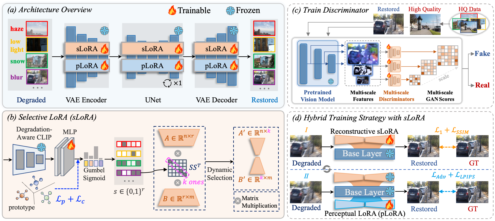

# PRISM-IR: Fine-Grained Expert Selection for All-in-One Image Restoration

[Aiping Zhang]()<sup>1,*</sup>, [Zongsheng Yue]()<sup>2,*</sup>, [Yuning Cui]()<sup>3</sup>, [Alois Knoll]()<sup>3</sup>, [Renjing Pei]()<sup>4</sup>, [Wenqi Ren]()<sup>1</sup>, [Xiaochun Cao]()<sup>1</sup>

<sup>1</sup>School of Cyber Science and Technology, Shenzhen Campus of Sun Yat-sen University, Shenzhen, China<br>
<sup>2</sup>School of Mathematics and Statistics, Xi'an Jiaotong University, Shaanxi, China<br>
<sup>3</sup>School of Computation, Information and Technology, Technical University of Munich, Munich, Germany<br>
<sup>4</sup>Huawei Noah's Ark Lab
</div>

:fire::fire::fire: We have released the code, cheers!

:star: If PRISM-IR is helpful for you, please help star this repo. Thanks! :hugs:

## Framework Overview



<!-- Replace assets/framework.svg with the framework figure. -->

## Visual Comparison


<!-- Replace assets/comparison.svg with the visual comparison figure. -->

## Installation

```bash
conda create -n prism-ir python=3.10
conda activate prism-ir
pip install -r requirements-training.txt
```

## Weights and Configuration

Download the weights for the selected setting. Download links will be added below.
[SD-Turbo](https://huggingface.co/stabilityai/sd-turbo) is downloaded automatically
when `sd_path` is `null`; a local path can also be used.

| Setting | Config | DA-CLIP (Google Drive) | Model (Google Drive) |
|---|---|---|---|
| 3-task | [ir_3task.yaml](configs/ir_3task.yaml) | [daclip_3_tasks.pt](https://drive.google.com/drive/folders/16gdP3a-ere7b4J9N260UFqRd5p5Ug1XA?usp=sharing) | [model_3_tasks.pkl](https://drive.google.com/file/d/1lo7sBZ41S5eedlb6GDR2HvMqAddjGlfG/view?usp=sharing) |
| 5-task | [ir_5task.yaml](configs/ir_5task.yaml) | [daclip_5_tasks.pt](https://drive.google.com/file/d/1NpzRoreqDKnK76U6ZwllN3AY8DFB3VTW/view?usp=sharing) | [model_5_tasks.pkl](https://drive.google.com/file/d/1uIlPJU8n8oPZbLU6jwmmbcThIIow0B5v/view?usp=sharing)|
| 10-task | [ir_10task.yaml](configs/ir_10task.yaml) | [daclip_10_tasks.pt](https://drive.google.com/file/d/1PgsccmPyyzEI6-l0rLSptMh54rcUZ9rJ/view?usp=sharing) | [model_10_tasks.pkl](https://drive.google.com/file/d/1QB2cVzHywMklHDLBHZ3b7zZmQBYCZbXl/view?usp=sharing) |

Use the corresponding filenames from the YAML:

| Setting | DA-CLIP | Model |
|---|---|---|
| 3-task | `daclip_3_tasks.pt` | `checkpoints/model_3_tasks.pkl` |
| 5-task | `daclip_5_tasks.pt` | `checkpoints/model_5_tasks.pkl` |
| 10-task | `daclip_10_tasks.pt` | `checkpoints/model_10_tasks.pkl` |

Set the dataset, DA-CLIP, and model paths in the selected YAML.
Paired datasets use `<dataset_root>/<task_folder>/{LQ,GT}`.
All training and testing settings are read from the YAML.

## Training

```bash
CUDA_VISIBLE_DEVICES=0 bash run_training.sh --base_config configs/ir_3task.yaml
```

```bash
CUDA_VISIBLE_DEVICES=0 bash run_training.sh --base_config configs/ir_5task.yaml
```

```bash
CUDA_VISIBLE_DEVICES=0 bash run_training.sh --base_config configs/ir_10task.yaml
```

## Testing

```bash
CUDA_VISIBLE_DEVICES=0 bash run_inference.sh --base_config configs/ir_3task.yaml
```

```bash
CUDA_VISIBLE_DEVICES=0 bash run_inference.sh --base_config configs/ir_5task.yaml
```

```bash
CUDA_VISIBLE_DEVICES=0 bash run_inference.sh --base_config configs/ir_10task.yaml
```

## Evaluation

```bash
CUDA_VISIBLE_DEVICES=0 bash run_evaluate.sh \
  -i /path/to/outputs -r /path/to/GT
```

## :smiley: Citation

Please cite us if our work is useful for your research.

```
@article{zhang2026prism,
  title=     {PRISM-IR: Fine-Grained Expert Selection for All-in-One Image Restoration},
  author=    {Zhang, Aiping and Yue, Zongsheng and Cui, Yuning and Knoll, Alois and Pei, Renjing and Ren, Wenqi and Cao, Xiaochun},
  journal=   {IEEE Transactions on Image Processing},
  year=      {2026},
  publisher= {IEEE}
}
```

## :notebook: License

This project is released under the [Apache 2.0 license](LICENSE).


## :envelope: Contact

If you have any questions, please feel free to contact zhangaip7@mail2.sysu.edu.cn.


## Acknowledgements

[S3Diff](https://github.com/ArcticHare105/S3Diff),
[DA-CLIP](https://github.com/Algolzw/daclip-uir),
[OpenCLIP](https://github.com/mlfoundations/open_clip), and
[Vision-aided GAN](https://github.com/nupurkmr9/vision-aided-gan).
[S3Diff license](src/S3Diff_LICENSE),
[OpenCLIP license](src/open_clip/LICENSE), and
[Vision-aided GAN license](src/vision_aided_loss/LICENSE).
